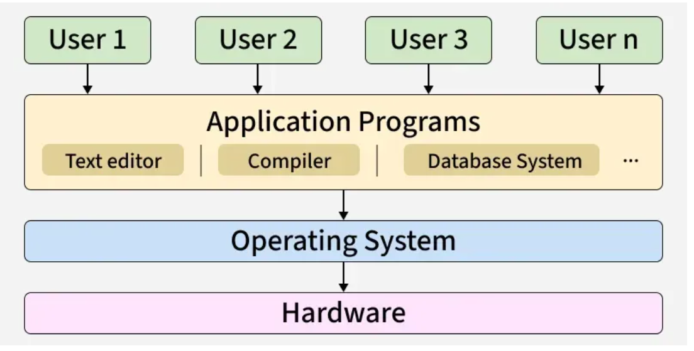

# Operating System & Linux Introduction

---

## 🧠 Core Concepts

* **What is an Operating System (OS)?**
  * Interacts with both software and hardware - it is the middle part between them.
  * 

* **Resource Allocation & Management:**
  * **CPU Management:**
    * 1 process at a time per CPU core.
    * 1 CPU core only processes 1 task at a time.
    * The CPU switches between tasks so fast that we don't notice it (time slicing / context switching).
  * **Memory Management:**
    * EVERY application needs working data in RAM.
    * When RAM gets full, the OS swaps memory between applications and disk storage (Swap space):
      * `RAM ----> Storage` (Swap out)
      * `RAM <---- Storage` (Swap in)

* **How an OS is Constructed:**
  * **Kernel:**
    * This part loads first during boot.
    * Heart of the OS.
    * Manages hardware components: CPU, memory (RAM), and storage.
    * Also handles input and output (I/O) devices.
  * **Application Layer:**
    * Sits on top of the kernel.
    * Different Linux distributions: Ubuntu, Linux Mint, CentOS, Debian, Fedora, Arch, etc.
    * Different applications and desktop environments, but all based on the same Linux kernel.
    * Android is also based on the Linux kernel.
    * macOS and iOS are based on the Darwin kernel.

* **Architecture Stack Example (Android):**
  ```text
  USER APPS     -->   Android Application Layer   -->   LINUX Kernel   -->   Hardware
  (Play Store)             (Framework / ART)                               (CPU, Storage, RAM)
  ```

---

---

## 🛠️ Playbook & Commands

**1. Inspect kernel and OS distribution details:**
```bash
# Print kernel name, release version, and machine architecture
uname -a

# Show Linux distribution release information
cat /etc/os-release
```

**2. Inspect CPU and memory resource allocation:**
```bash
# Check CPU architecture, cores, and threads
lscpu

# Check total, used, and free RAM and Swap space
free -h

# Monitor real-time CPU and memory usage by process
top
```
