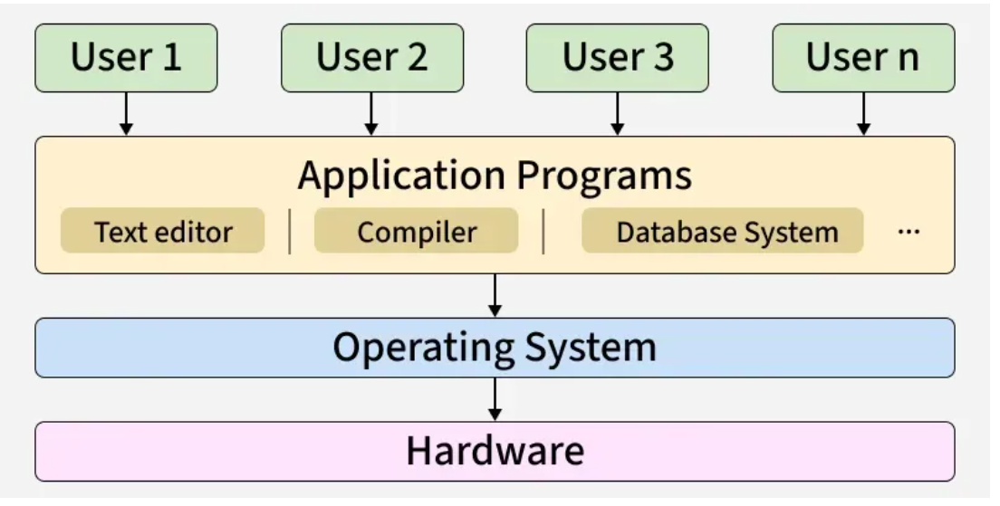

# OS 
- can be interact with both software and hardware. it is middle part of it.
- 

## resource allocation management
1. CPU 
   1. 1 process at a time 
   2. 1 cpu only process 1 task at a time 
   3. cpu switch so fast that we dont notice it 
2. Memory managmenat 
   1. EVERY application need working data
   2. when ram s get full os swa ,e,eomey b/w applicatiom
   3. RAM ----> storage 
   4. RAM <--- storage 

## how OS Constructed 
1. kernal 
   1. this part load first 
   2. heart of os
   3. managing hardwaqre componenet, CPU, memeory , RAM.
   4. also handle input output devices 
2. Application latyer 
   1. diffrent linux distribition :- ubuntu, mint, centos, Debian etc.
   2. diff application but based on same jkernal.
   3. application layer is top of kernal
   4. android is also basedd on linux kernal
   5. macos and ios are based on darwin kernal

ANDROID : USER APPS --> Android --> LINUX -- > hardware
            play    apllication      kernal     CPU, STORAGE
            store     layer                         RAM

